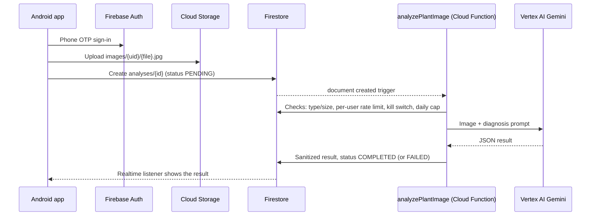

# 🌾 Krishi Rakshak AI

**Photo-based plant disease detection for farmers, in their own language.**

Krishi Rakshak AI ("farmer protector") is an open-source Android app. A farmer photographs a sick leaf. The app names the plant and the likely disease, says how severe it is, and suggests practical treatment and prevention steps. The analysis runs on Google's Gemini model behind a small Firebase backend that you host yourself.

[](https://github.com/mraja775/krishi-rakshak-ai/actions/workflows/ci.yml)
[](LICENSE)

> **Status:** early (v1.0.0). The app works end to end, but it isn't on the Play Store yet. Contributions are welcome. See [CONTRIBUTING.md](CONTRIBUTING.md).

<!-- Screenshots: add images under docs/images/ and reference them here. -->
| Home | Result | History |
|------|--------|---------|
| _screenshot_ | _screenshot_ | _screenshot_ |

## Features

- 📷 **Capture or pick a photo.** CameraX capture or the system photo picker. Images are compressed on the device before upload.
- 🤖 **AI diagnosis.** Plant type, disease name and scientific name, severity (LOW / MODERATE / SEVERE / CRITICAL), confidence, symptoms, causes, prevention and recommendations.
- 🗂️ **History.** Past analyses are kept per user and cached on the device.
- 🔐 **Phone-number login.** Firebase Phone Auth with an OTP code.
- 🌐 **Languages.** English, हिन्दी, தமிழ், ಕನ್ನಡ.
- 🛡️ **Locked-down backend.** Each user can only touch their own data. Only the backend writes results. Spend has hard limits: a per-user rate limit, a global daily cap, a kill switch and a budget guard.

## How it works



More detail: [docs/ARCHITECTURE.md](docs/ARCHITECTURE.md).

## Tech stack

| Layer | Technology |
|-------|------------|
| Android | Kotlin, Jetpack Compose (Material 3), MVVM + clean architecture, Hilt, Room, CameraX, Coil, WorkManager, Timber |
| Backend | Firebase Auth (phone), Cloud Firestore, Cloud Storage, Cloud Functions (2nd gen, Node.js 22, TypeScript) |
| AI | Vertex AI Gemini (`gemini-3.8-flash` by default, configurable) |
| Protection | Firestore and Storage security rules, Firebase App Check (Play Integrity), budget guard |

Requirements: Android 8.0+ (API 26). Builds with JDK 17 (Android Studio's bundled JBR works).

## Quick start

You need your **own** Firebase project. This repository doesn't include anyone's credentials.

```bash
git clone https://github.com/mraja775/krishi-rakshak-ai.git
cd krishi-rakshak-ai
```

1. Create a Firebase project and download `app/google-services.json` for the package `com.krishirakshak.app`. See [docs/SETUP.md](docs/SETUP.md).
2. Point the CLI at your project: `cp .firebaserc.example .firebaserc && firebase use --add`
3. **Before deploying, set up the cost controls in [docs/COST_CONTROLS.md](docs/COST_CONTROLS.md).**
4. Deploy the backend: `firebase deploy --only firestore,storage,functions`
5. Build and install: `./gradlew installDebug`

## Documentation

| Doc | What's in it |
|-----|--------------|
| [docs/SETUP.md](docs/SETUP.md) | Self-hosting from scratch: Firebase, Vertex AI, building and running |
| [docs/COST_CONTROLS.md](docs/COST_CONTROLS.md) | How runaway spend is prevented, plus the **required** console steps |
| [docs/SECURITY_MODEL.md](docs/SECURITY_MODEL.md) | Security-rule design, and what's public versus secret |
| [docs/ARCHITECTURE.md](docs/ARCHITECTURE.md) | App layers and the analysis pipeline |
| [docs/TESTING.md](docs/TESTING.md) | Rules tests, function checks, Android builds |
| [SECURITY.md](SECURITY.md) | How to report a vulnerability (privately) |
| [CONTRIBUTING.md](CONTRIBUTING.md) | Development workflow and PR checklist |

## Disclaimer

AI diagnoses can be wrong. The app gives guidance only. It doesn't replace advice from a qualified agronomist or your local agricultural extension office, especially before you use chemical treatments.

## License

[Apache License 2.0](LICENSE) © 2026 Raja Mohan
